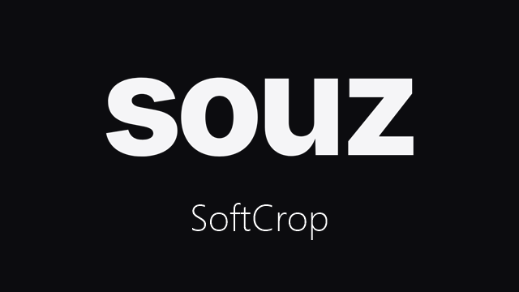

# Souz Toolkit — SoftCrop 1.4



Plugin original para Resolume, Windows x64 e FFGL 2.1. Recorte simétrico com suavização simétrica por eixo horizontal e vertical. Código próprio; não contém a DLL proprietária SoftCropper.

## Baixar a versão atual

- [DLL v1.4 — download direto](https://github.com/oSouz/SoftCrop/raw/refs/heads/main/dist/SouzSoftCrop_v14_FFGL21.dll)
- [Pacote completo v1.4](https://github.com/oSouz/SoftCrop/raw/refs/heads/main/SouzToolkit_SoftCrop_FFGL21_v1.4.zip)

## Instalar esta atualização

1. Feche o Resolume.
2. Copie `dist/SouzSoftCrop_v14_FFGL21.dll` para uma pasta que esteja configurada nos diretórios de plugins FFGL do Resolume.
3. Abra o Resolume e procure o efeito **Souz SoftCrop 14**. Esse é o nome da nova versão. O efeito antigo **Souz Soft Crop** pode continuar em composições anteriores.
4. Retire o efeito antigo do clipe e aplique **Souz SoftCrop 14**. Substituir um arquivo não troca automaticamente uma instância de efeito numa composição.
5. Confirme os dois controles **Crop Horizontal** e **Crop Vertical** e a thumbnail Souz/SoftCrop.

A versão 1.4 substitui os quatro controles Soft por Soft Horizontal e Soft Vertical.

A DLL nova tem nome de arquivo e ID próprios (`SZC4`) para distingui-la das versões anteriores (`SZC1`). Os presets/instâncias antigos não migram automaticamente. Não instale as duas DLLs de `dist` juntas: o nome sem v14 é apenas um alias com os mesmos bytes para manter o link antigo atualizado. Use a DLL com v14.

Se o efeito novo não aparecer, confirme o diretório FFGL nas preferências de vídeo e reinicie o Resolume. A thumbnail do efeito usa a imagem Souz enviada pelo usuário, com SoftCrop abaixo; a imagem de um slot de clipe depende do comportamento do host. A marca não aparece sobre o vídeo processado.

## Thumbnail embutida — comparação com GridPanel

Na versão 1.3, a implementação foi alinhada ao código do GridPanel do usuário: imagem de 640×360, pixels CFFGLColor no formato numérico 0xRRGGBBAA e registro estático CFFGLThumbnailInfo. A versão 1.2 usava 160×120 e palavras no formato numérico 0xAABBGGRR; essa diferença foi corrigida. A imagem completa está dentro da DLL: não depende de PNG ou arquivo AVC no computador de quem recebe.

Os testes consultam a API e verificam cada palavra de pixel, incluindo alfa. Isso confirma o conteúdo entregue pelo plugin, mas não comprova como o Resolume o usa no slot do clipe. A verificação visual no host permanece pendente. Não há garantia de que o host substitua uma thumbnail já salva numa composição antiga; para testar esta versão, use uma instância nova de **Souz SoftCrop 14**.

O pacote experimental de composição da versão 1.2 fica como histórico e não é necessário para esta implementação de thumbnail embutida.

## Controles

| Índice | Controle | Função |
|---|---|---|
| 0 | Crop Horizontal | Corta esquerda e direita igualmente |
| 1 | Crop Vertical | Corta cima e baixo igualmente |
| 2 | Soft Horizontal | Suaviza esquerda e direita igualmente |
| 3 | Soft Vertical | Suaviza cima e baixo igualmente |
| 4 | Corner Blend | 0: produto das máscaras; 1: mínimo; valores intermediários interpolam |

Todos começam em zero e variam de 0 a 1. Os cortes são frações removidas de **cada** lado: Horizontal=0,20 remove 20% à esquerda e 20% à direita, restando 60% no centro. Com 0,50 ou mais em qualquer eixo, a imagem desaparece. Esta versão usa dois controles para evitar que o host envie valores concorrentes a controles vinculados.

Soft Horizontal e Soft Vertical atuam separadamente: aumentar um não altera o outro. Os dois lados de cada eixo recebem a mesma suavização. Soft=0 produz corte seco. A suavização usa smoothstep e avança da borda do corte para dentro da região visível. Suas distâncias são frações do eixo correspondente. O shader preserva RGBA pré-multiplicado e o tamanho útil da textura FFGL; não redimensiona o conteúdo.

## Compilar

Windows x64, Visual Studio 2022/Build Tools com Desenvolvimento para desktop com C++, Windows SDK e CMake 3.20+. Python 3 x64 é opcional para consultar metadados e thumbnail.

```powershell
cmake -S . -B build -G "Visual Studio 17 2022" -A x64
cmake --build build --config Release --parallel 4
ctest --test-dir build -C Release --output-on-failure
python tests/check_metadata.py build/bin/Release/SouzSoftCrop_v14_FFGL21.dll
```

Saída: `build/bin/Release/SouzSoftCrop_v14_FFGL21.dll`.

O SDK público incluído está fixado em [resolume/ffgl v2.1](https://github.com/resolume/ffgl/tree/v2.1), commit `6697342f153cba9df9fd089a56d29ca87712fe30`. Pode usar outro checkout dessa versão com `-DFFGL_SDK="C:/caminho/ffgl"`. Para obter o SDK quando não estiver incluído:

```powershell
git clone --branch v2.1 --depth 1 https://github.com/resolume/ffgl.git vendor/ffgl
```

A thumbnail já está embutida em `src/SouzThumbnail.h`. Para recriá-la no Windows, execute `powershell -ExecutionPolicy Bypass -File tools/make_thumbnail.ps1` e recompile. Os arquivos PNG estão em `assets`.

## Validação e limites

Build Release MSVC 19.44, SDK Windows 10.0.26100. Testes aprovados de parâmetros, retorno a zero, eixos independentes, suavizações por eixo, limites e entrada inválida. API consultada: FFGL 2.1, nome Souz SoftCrop 14, ID SZC4 e cinco parâmetros. Thumbnail consultada pela API e comparada pixel a pixel com o cabeçalho embutido.

Não foi executada uma sessão de Resolume nem validada a renderização em GPU nesta entrega. A inspeção do plugin proprietário foi estática; não há promessa de igualdade pixel a pixel ou de compatibilidade com presets dele. O SDK v2.1 documenta suporte às suas funcionalidades a partir do Resolume 7.0.3. O shader exige OpenGL/GLSL 4.1 e a DLL requer runtime Visual C++ x64.

## Arquivos e autoria

`src`: efeito C++/GLSL e thumbnail; `tests`: verificações; `tools`: inspeção PE e geração da arte; `analysis`: evidências; `RELATORIO.md`: análise do original; `vendor/ffgl`: SDK oficial e seus avisos de copyright. Versões ZIP antigas ficam disponíveis como histórico.

O código do efeito foi escrito do zero a partir de matemática comum e da API pública FFGL. Nenhum shader ou código descompilado do plugin de referência foi reutilizado. Consulte `LICENSE` e `THIRD_PARTY_NOTICES.md`. O logo fornecido pelo usuário permanece sujeito aos direitos de seu titular.
